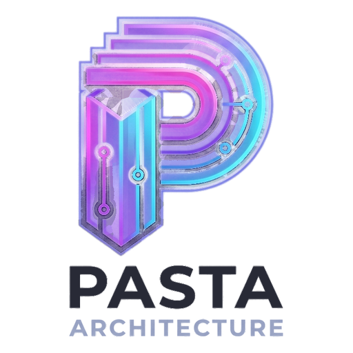
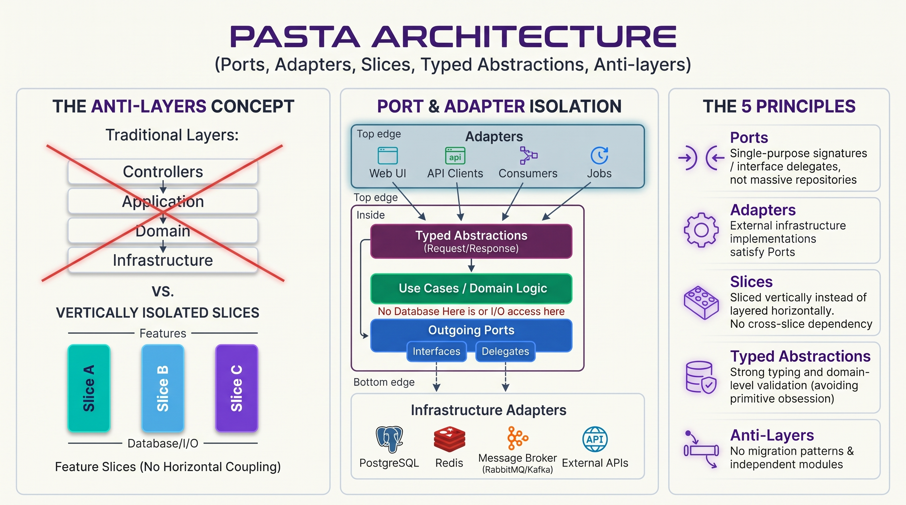
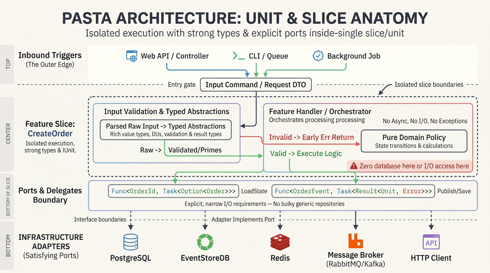
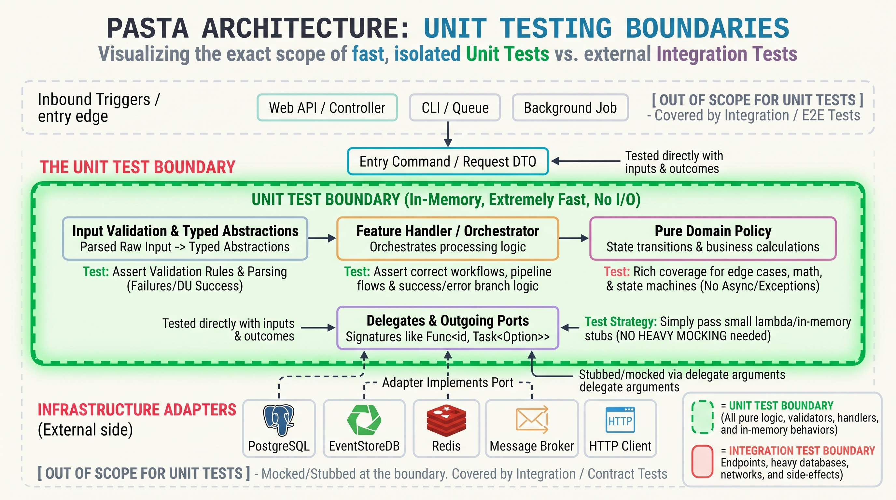
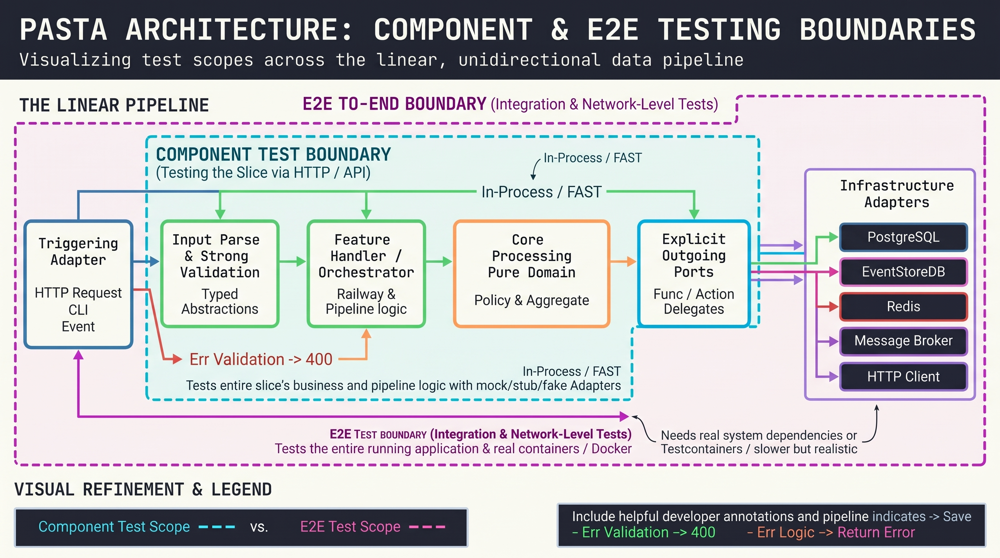

<p align="center">
  <picture>
    <source media="(prefers-color-scheme: dark)" srcset="assets/logos/png/full-dark/pasta-option-a-dark-512x512.png" />
    <source media="(prefers-color-scheme: light)" srcset="assets/logos/png/full-light/pasta-option-a-light-512x512.png" />
    
  </picture>
</p>

<h3 align="center">
  <b>P</b>orts 🔹 <b>A</b>dapters 🔹 <b>S</b>lices 🔹 <b>T</b>yped Abstractions 🔹 (<b>A</b>nti-Layers)
</h3>

<p align="center">
  <b>A minimalist, functional-first architecture for building modular, testable, and maintainable systems in modern .NET and beyond.</b>
</p>

<p align="center">
  <a href="#-6-add-the-pasta-badge-to-your-project"></a>
  <a href="https://dotnet.microsoft.com/"></a>
  <a href="https://www.nuget.org/packages/FunqTypes"></a>
  <a href="skills/SKILL.md"></a>
  <a href="LICENSE"></a>
</p>

<p align="center">
  <a href="#-the-pasta-manifesto">Manifesto</a> •
  <a href="#-1-overall-architecture">Architecture</a> •
  <a href="#-2-unit--slice-anatomy">Slice Anatomy</a> •
  <a href="#-3-testing-strategy--boundaries">Testing Boundaries</a> •
  <a href="#-4-sample-application-pastafit">Sample App</a> •
  <a href="#-5-ai-agent-skill">AI Skill</a> •
  <a href="#-6-add-the-pasta-badge-to-your-project">Badges</a>
</p>

---

## 🪶 The PASTA Manifesto

> *"Layered systems are like overcooked spaghetti - sticky, tangled, and a pain to digest. **PASTA** serves it al dente."*

Traditional enterprise architectures drown simple business problems in ceremony: horizontal project layers, pass-through services, generic repositories, and interface-per-class indirection. **PASTA** distills **Hexagonal Architecture (Ports & Adapters)**, **Functional Core / Imperative Shell (FCIS)**, and **Vertical Slice Architecture** into a lean, pragmatic design:

- **No service or repository interfaces** - Ports are typed function delegates (`Func<>` / `Action<>`).
- **No anemic horizontal layers** - Features live in self-contained vertical slices.
- **No domain exceptions for control flow** - Predictable outcomes flow through Railway-Oriented Programming (`Result<T, E>`, `Option<T>`).
- **No heavy mocking frameworks** - Pure functions and delegate ports make testing trivial with inline lambdas.

---

## 🏛️ 1. Overall Architecture

<p align="center">
  <picture>
    <source media="(prefers-color-scheme: dark)" srcset="assets/images/pasta_arch_dark.jpg" />
    <source media="(prefers-color-scheme: light)" srcset="assets/images/pasta_arch_light.jpg" />
    
  </picture>
</p>

### The 5 Pillars of PASTA

| Pillar | Principle | What It Means in Practice |
| :--- | :--- | :--- |
| **P - Ports** | **Narrow Function Signatures** | Outbound I/O capabilities are modeled as single-purpose delegates or `Func<>`/`Action<>` records - never bloated `IRepository<T>` or `IFooService` interfaces. |
| **A - Adapters** | **Infrastructure at the Edges** | Concrete infrastructure bindings (PostgreSQL, Redis, RabbitMQ/Kafka, external HTTP APIs) live at the outer edges and satisfy Port signatures. |
| **S - Slices** | **Vertical Feature Isolation** | Code is organized vertically by business capability (`CreateOrder`, `CancelBooking`) rather than split horizontally across `Controllers/`, `Services/`, and `Repositories/`. Zero cross-slice coupling. |
| **T - Typed Abstractions** | **Deep Domain Type Safety** | Eliminates primitive obsession using immutable `record` types, zero-allocation strongly-typed IDs (`readonly record struct`), and algebraic types (`Result<T, E>`, `Option<T>` via [`FunqTypes`](https://www.nuget.org/packages/FunqTypes)). |
| **A - Anti-Layers** | **Zero Pass-Through Ceremony** | Eliminates artificial `Controller → Service → Manager → Repository → DAO` chains. Inbound triggers invoke the slice orchestrator directly. |

### Anti-Layers & Port Isolation

1. **Top Edge (Inbound Adapters):** Web UI, Minimal APIs, CLI commands, message consumers, and background jobs act as entry triggers that deserialize requests and invoke the slice.
2. **Inside (The Slice Core):**
   - **Typed Abstractions** validate and represent the domain state and inputs/outputs.
   - **Use Cases & Domain Logic** execute pure business rules with **zero database or I/O access**.
   - **Outgoing Ports** define the exact delegate signatures required to load or persist state.
3. **Bottom Edge (Infrastructure Adapters):** Real databases, caches, message brokers, and third-party APIs implement the outgoing delegates at the boundary.

> [!NOTE]
> **Why Explicit Input Ports Are Optional:** In modern .NET, Minimal APIs and message handlers already serve as lightweight inbound adapters, while the slice handler method (`CreateBookingHandler.Handle`) acts as the de facto input port. Introduce explicit input ports only when multiple transport triggers (e.g., HTTP + gRPC + CLI) share complex input mapping.

---

## 🧬 2. Unit & Slice Anatomy

<p align="center">
  <picture>
    <source media="(prefers-color-scheme: dark)" srcset="assets/images/pasta_unit_slice_dark.jpg" />
    <source media="(prefers-color-scheme: light)" srcset="assets/images/pasta_unit_slice_light.jpg" />
    
  </picture>
</p>

Each feature forms an **isolated vertical slice** partitioned using **Functional Core, Imperative Shell (FCIS)** and connected via a linear **Railway-Oriented Programming (ROP)** pipeline:

### 1. Inbound Triggers (The Outer Edge)
- **Web API / Minimal API**, **CLI / Queue Consumers**, or **Background Jobs** receive raw external input and pass an **Input Command / Request DTO** through the entry gate into the slice boundary.

### 2. Feature Slice Center (`CreateOrder` / `CreateBooking`)
Inside the dashed slice boundary, **zero direct database or I/O dependencies exist**:
- **Input Validation & Typed Abstractions:** Raw inputs are parsed and validated into strongly-typed domain primitives, value objects, and discriminated unions.
  - 🔴 **Invalid Input:** Short-circuits immediately with an early typed `Result.Fail(Error)` return.
  - 🟢 **Valid Input:** Continues along the success track to execute domain logic.
- **Feature Handler / Orchestrator (Imperative Shell):** Coordinates the workflow - loading state through ports, invoking the pure domain policy, and committing side effects through ports using monadic composition (`.Bind`, `.BindAsync`, `.Map`).
- **Pure Domain Policy (Functional Core):** Contains state transitions, invariant checks, and business calculations. Strictly **synchronous, deterministic, no async, no I/O, and no exceptions**.

### 3. Ports & Delegates Boundary (Bottom of Slice)
- Instead of injecting broad interfaces, the slice declares narrow, explicit `Func<>` delegate requirements inside a `record`:
  ```csharp
  public sealed record CreateBookingPorts(
      Func<MemberId, CancellationToken, ValueTask<Option<Member>>> GetMember,
      Func<ClassId, CancellationToken, ValueTask<Option<Class>>> GetClass,
      Func<ClassId, CancellationToken, ValueTask<int>> CountClassBookings,
      Func<MemberId, ClassId, CancellationToken, ValueTask<bool>> HasExistingBooking,
      Func<Booking, CancellationToken, ValueTask<Result<Unit, BookingError>>> SaveBooking
  );
  ```

### 4. Pure Domain Policy + Railway Handler in Action
- **Pure Domain Core (`BookingPolicy.cs`)** - Synchronous, deterministic, zero I/O, using `Result.Combine` from `FunqTypes` to accumulate all rule violations at once:
  ```csharp
  public static Result<Booking, BookingError> Create(
      Member member, Class gymClass, int activeBookingsCount, bool hasExistingBooking, DateTimeOffset nowUtc)
  {
      var memberActiveCheck = member.IsActive
          ? Result<Unit, BookingError>.Ok(Unit.Value)
          : Result<Unit, BookingError>.Fail(new BookingError.MemberInactive());

      var notAlreadyBookedCheck = !hasExistingBooking
          ? Result<Unit, BookingError>.Ok(Unit.Value)
          : Result<Unit, BookingError>.Fail(new BookingError.AlreadyBooked());

      var capacityCheck = activeBookingsCount < gymClass.Capacity
          ? Result<Unit, BookingError>.Ok(Unit.Value)
          : Result<Unit, BookingError>.Fail(new BookingError.ClassFull());

      return Result.Combine(memberActiveCheck, notAlreadyBookedCheck, capacityCheck)
          .Map((_, _, _) => new Booking(BookingId.New(), member.Id, gymClass.Id, nowUtc));
  }
  ```
- **Imperative Shell Orchestrator (`CreateBookingHandler.cs`)** - Composes input validation, port lookups, pure policy evaluation, and persistence on a single railway track:
  ```csharp
  public static async Task<Result<Booking, BookingError>> Handle(
      CreateBookingCommand command, CreateBookingPorts ports, TimeProvider timeProvider, CancellationToken ct = default)
  {
      return await Result.Combine(MemberId.From(command.MemberId), ClassId.From(command.ClassId))
          .BindAsync(async (memberId, classId) =>
          {
              var memberResult = (await ports.GetMember(memberId, ct)).ToResult<BookingError>(new BookingError.MemberNotFound());
              var classResult = (await ports.GetClass(classId, ct)).ToResult<BookingError>(new BookingError.ClassNotFound());

              return await Result.Combine(memberResult, classResult)
                  .BindAsync(async (member, gymClass) =>
                  {
                      var activeCount = await ports.CountClassBookings(classId, ct);
                      var alreadyBooked = await ports.HasExistingBooking(memberId, classId, ct);
                      return BookingPolicy.Create(member, gymClass, activeCount, alreadyBooked, timeProvider.GetUtcNow());
                  });
          })
          .BindAsync(async booking => (await ports.SaveBooking(booking, ct)).Map(_ => booking));
  }
  ```

### 5. Infrastructure Adapters (Bottom Edge)
- Concrete adapters (**PostgreSQL**, **EventStoreDB**, **Redis**, **RabbitMQ/Kafka**, **HTTP Clients**) provide functions matching the port delegates and are wired up at the application composition root.

### Canonical Slice Folder Structure (`PastaFit`)

```text
src/PastaFit/
├── Core/Domain/
│   ├── Identifiers.cs               # [T] Strongly-typed IDs (BookingId, MemberId, ClassId)
│   ├── Booking.cs / Class.cs        # [T] Immutable domain records
│   ├── BookingError.cs              # [T] Closed error hierarchy
│   └── BookingPolicy.cs             # [T] Pure Domain Core: Synchronous rules & Result.Combine
├── Features/Booking/
│   ├── CreateBooking/               # [S] Vertical Slice: Create Booking
│   │   ├── CreateBookingPorts.cs    # [P] Ports Boundary: Record of narrow Func<> delegates
│   │   ├── CreateBookingHandler.cs  # [A] Anti-Layer Orchestrator: Imperative Shell & Railway pipeline
│   │   └── CreateBookingEndpoint.cs # [S] Inbound Minimal API trigger (POST /bookings)
│   ├── CancelBooking/               # [S] Vertical Slice: Cancel Booking
│   │   ├── CancelBookingPorts.cs    # [P] Ports Boundary: Record of narrow Func<> delegates
│   │   ├── CancelBookingHandler.cs  # [A] Anti-Layer Orchestrator: Imperative Shell & Railway pipeline
│   │   └── CancelBookingEndpoint.cs # [S] Inbound Minimal API trigger (DELETE /bookings/{id})
│   ├── Adapters/                    # [A] Outbound Adapters satisfying slice ports
│   │   ├── InMemoryBookingAdapter.cs
│   │   └── PostgresBookingAdapter.cs
│   └── BookingFeatureEndpoints.cs   # Feature endpoint registration & error -> HTTP IResult mapping
└── Shell/
    └── Infrastructure/DI.cs         # Composition root wiring Adapters -> Ports
```

---

## 🧪 3. Testing Strategy & Boundaries

Because PASTA isolates pure business rules from I/O and replaces multi-method interfaces with simple delegates, testing becomes fast, deterministic, and completely free of mocking framework ceremony.

| Test Level | Scope | What Is Stubbed | Speed & Characteristics |
| :--- | :--- | :--- | :--- |
| **Unit Tests** | `Validation + Handler + Pure Domain Policy + Port Delegates` | Outgoing Port delegates (via inline lambdas) | ⚡ **Instant (In-Memory, Zero I/O)** - Tests all domain logic, state transitions, and handler branching. |
| **Component Tests** | `Triggering Adapter (HTTP) → Slice → Outgoing Ports` | Only the Infrastructure Adapter implementation (in-memory/fake) | 🚀 **Fast (In-Process HTTP)** - Verifies routing, serialization, validation (`400`), and full slice orchestration. |
| **E2E / Integration Tests** | `Full Pipeline + Real Infrastructure Adapters` | Only unowned 3rd-party external systems | 🐳 **Realistic (Docker / Testcontainers)** - Verifies SQL queries, network boundaries, and real infrastructure. |

---

### 🔬 3.1 Unit Testing Boundaries

<p align="center">
  <picture>
    <source media="(prefers-color-scheme: dark)" srcset="assets/images/pasta_unit_testing_dark.jpg" />
    <source media="(prefers-color-scheme: light)" srcset="assets/images/pasta_unit_testing_light.jpg" />
    
  </picture>
</p>

Unit tests target everything **inside the green boundary** by sending an **Entry Command / Request DTO** directly into the slice:

- **Input Validation & Typed Abstractions:** Assert parsing rules, value constraints, and error union outcomes.
- **Feature Handler / Orchestrator:** Assert workflow sequencing, railway short-circuiting, and success/error branch handling.
- **Pure Domain Policy:** Exhaustively test edge cases, business math, and state machines synchronously with zero setup.
- **Delegates & Outgoing Ports (Zero Mocking Frameworks):** Instead of `Moq` or `NSubstitute`, pass one-line lambda expressions directly into the port record:

```csharp
[Fact]
public async Task Fails_If_Class_Is_Full()
{
    var ports = new CreateBookingPorts(
        GetMember: (id, _) => ValueTask.FromResult(Option<Member>.Some(new Member(id, "Alice", true))),
        GetClass: (id, _) => ValueTask.FromResult(Option<Class>.Some(new Class(id, "Yoga", 5))),
        CountClassBookings: (_, _) => ValueTask.FromResult(5), // <-- Inline lambda stub: class at capacity!
        HasExistingBooking: (_, _, _) => ValueTask.FromResult(false),
        SaveBooking: (_, _) => ValueTask.FromResult(Result<Unit, BookingError>.Ok(Unit.Value))
    );

    var result = await CreateBookingHandler.Handle(
        new CreateBookingCommand(Guid.NewGuid(), Guid.NewGuid()),
        ports,
        TimeProvider.System);

    Assert.False(result.IsSuccess);
    Assert.Contains(result.Errors, e => e is BookingError.ClassFull);
}
```

> **Out of Scope for Unit Tests:** Inbound HTTP/CLI triggers and external infrastructure adapters (PostgreSQL, Redis, brokers) sit outside the unit boundary and are covered by Component and E2E tests.

---

### 🌐 3.2 Component & E2E Testing Boundaries

<p align="center">
  <picture>
    <source media="(prefers-color-scheme: dark)" srcset="assets/images/pasta_component_e2e_testing_dark.jpg" />
    <source media="(prefers-color-scheme: light)" srcset="assets/images/pasta_component_e2e_testing_light.jpg" />
    
  </picture>
</p>

Across the linear, unidirectional pipeline, PASTA distinguishes between **In-Process Component Tests** and **Full E2E / Integration Tests**:

#### 🟦 Component Test Boundary (In-Process / Fast)
- Exercises the slice from the **Triggering Adapter** (`WebApplicationFactory<Program>` HTTP client) through **Input Parsing & Validation**, **Feature Handler**, **Core Domain**, and **Outgoing Ports**, backed by lightweight in-memory or fake adapters.
- Verifies that invalid inputs map to `400 Bad Request`, domain errors map to proper HTTP problem responses, and DI wiring works end-to-end - all in milliseconds without spinning up external servers.

```csharp
[Fact]
public async Task Can_Book_Detect_Conflict_And_Cancel_Class()
{
    var members = await _client.GetFromJsonAsync<List<Member>>("/members");
    var classes = await _client.GetFromJsonAsync<List<ClassAvailability>>("/classes");

    var req = new { memberId = members!.First(m => m.IsActive).Id.Value, classId = classes!.First().Id };

    var bookResp = await _client.PostAsJsonAsync("/bookings", req);
    Assert.Equal(HttpStatusCode.Created, bookResp.StatusCode);

    var duplicateResp = await _client.PostAsJsonAsync("/bookings", req);
    Assert.Equal(HttpStatusCode.Conflict, duplicateResp.StatusCode);

    var booking = await bookResp.Content.ReadFromJsonAsync<Booking>();
    var cancelResp = await _client.DeleteAsync($"/bookings/{booking!.Id.Value}");
    Assert.Equal(HttpStatusCode.NoContent, cancelResp.StatusCode);
}
```

#### 🟪 E2E / Integration Test Boundary (Network & Container Level)
- Extends the boundary to include real **Infrastructure Adapters** (PostgreSQL, EventStoreDB, Redis, RabbitMQ/Kafka, HTTP Clients) running in Docker or **Testcontainers**.
- Validates real database queries, schema initialization, serialization, and network resilience across the complete deployed topology-while **zero lines of Domain, Handler, Port, or Endpoint code change**:

```csharp
public sealed class BookingPostgresE2ETests : IAsyncLifetime
{
    private readonly PostgreSqlContainer _postgres = new PostgreSqlBuilder()
        .WithImage("postgres:17-alpine")
        .Build();

    // Injects the Testcontainers PostgreSQL connection string into WebApplicationFactory<Program>,
    // automatically switching DI from InMemoryBookingAdapter to PostgresBookingAdapter!
}
```

---

## 🏋️‍♂️ 4. Sample Application: PastaFit

`src/PastaFit` is a reference .NET application demonstrating **PASTA Architecture** in a fitness class booking domain.

### Domain & Capabilities
- **Typed Abstractions & Pure Core (`Core/Domain`):**
  - Strongly-typed IDs (`BookingId`, `MemberId`, `ClassId`) with validation returning `Result<TId, BookingError>`.
  - Domain records (`Booking`, `Class`, `Member`) and closed error hierarchy `BookingError` (`InvalidInput`, `MemberNotFound`, `MemberInactive`, `AlreadyBooked`, `ClassFull`, `ClassNotFound`, `BookingNotFound`).
  - **`BookingPolicy` (Pure Functional Core):** Synchronous, deterministic invariant validation using `FunqTypes` `Result.Combine(...)` to accumulate all violated domain rules at once.
- **Use Cases & Adapters (`Features/Booking`):**
  - `CreateBookingHandler` & `CreateBookingPorts` (`Func<..., CancellationToken, ValueTask<...>>` record)
  - `CancelBookingHandler` & `CancelBookingPorts`
  - **Dual Adapters (Zero Core/Handler Changes):** `InMemoryBookingAdapter` (default for local dev & fast Component Tests) and `PostgresBookingAdapter` (Dapper + Npgsql for production & Testcontainers E2E Tests).

### Project Structure

```text
pasta-arch/
├── assets/
│   ├── badges/                      # Official PASTA badges (Dark/Light SVG, Flat-Square, Shields.io JSON)
│   ├── images/                      # Dark & light architecture and testing boundary diagrams
│   └── logos/                       # Official PASTA logos & icons (SVG, PNG, ICO)
├── skills/
│   └── SKILL.md                     # AI Coding Agent Skill for PASTA Architecture (.NET 10+)
├── src/
│   └── PastaFit/
│       ├── Core/Domain/             # Strongly-typed IDs, records, BookingError & pure BookingPolicy
│       ├── Features/Booking/
│       │   ├── CreateBooking/       # CreateBookingEndpoint, CreateBookingHandler & CreateBookingPorts
│       │   ├── CancelBooking/       # CancelBookingEndpoint, CancelBookingHandler & CancelBookingPorts
│       │   ├── Ports/               # BookingQueryPorts (Func<> record)
│       │   ├── Adapters/            # InMemoryBookingAdapter & PostgresBookingAdapter (Dapper/Npgsql)
│       │   └── BookingFeatureEndpoints.cs
│       └── Shell/Infrastructure/    # DI composition root wiring Adapters -> Ports
└── test/
    ├── PastaFit.UnitTests/          # Pure BookingPolicy tests & mock-free handler tests
    ├── PastaFit.ComponentTests/     # Fast in-process HTTP component tests (InMemory adapter)
    └── PastaFit.E2ETests/           # Full E2E tests with real PostgreSQL via Testcontainers
```

### Quick Start

#### Option A: Run with In-Memory Adapter (Zero Dependencies)
```bash
dotnet run --project src/PastaFit
```

#### Option B: Run with Real PostgreSQL Adapter (Docker)
```bash
docker run -d --name pastafit-db -e POSTGRES_PASSWORD=postgres -p 5432:5432 postgres:17-alpine

ConnectionStrings__Postgres="Host=localhost;Database=postgres;Username=postgres;Password=postgres" \
  dotnet run --project src/PastaFit
```

#### Run the 3-Tier Test Suite
```bash
# 1. Fast Unit Tests (Pure Core & Mock-Free Handlers - ~30ms, no Docker needed)
dotnet test test/PastaFit.UnitTests

# 2. Fast Component Tests (In-Process HTTP via WebApplicationFactory - ~400ms, no Docker needed)
dotnet test test/PastaFit.ComponentTests

# 3. Full E2E Tests (Spins up PostgreSQL via Testcontainers - requires Docker)
dotnet test test/PastaFit.E2ETests
```

### 📡 Interactive API Requests ([`PastaFit.http`](src/PastaFit/PastaFit.http))

Once running on `http://localhost:5247`, open **[`src/PastaFit/PastaFit.http`](src/PastaFit/PastaFit.http)** in Rider, Visual Studio, or VS Code (REST Client) to execute pre-configured requests with seeded IDs out of the box:

| Method | Route | Scenario Covered in `PastaFit.http` |
| :--- | :--- | :--- |
| `GET` | `/classes` | List all gym classes (`Yoga`, `Spin`) and real-time available capacity |
| `GET` | `/members` | List all seeded members (`Alice` active, `Bob` inactive, etc.) |
| `POST` | `/bookings` | `201 Created` (valid), `409 Conflict` (duplicate), `422` (inactive member), `400` (accumulated validation errors) |
| `DELETE` | `/bookings/{id}` | `204 No Content` - automatically chains `@bookingId` from the `POST` response |

---

## 🤖 5. AI Agent Skill

Want your AI coding assistant (Claude Code, Antigravity, Cursor, GitHub Copilot, Windsurf) to write idiomatic **PASTA Architecture** code out of the box?

This repository includes a ready-to-use, comprehensive AI Skill at **[`skills/SKILL.md`](skills/SKILL.md)** covering:
- **P.A.S.T.A.** architectural constraints and anti-layer rules
- **Functional Core, Imperative Shell (FCIS)** partitioning
- Granular `Func<>` / `Action<>` port records returning `ValueTask`
- Railway-Oriented Programming pipelines with **`FunqTypes`** (`.Bind`, `.BindAsync`, `.Map`, `.Match`)
- Zero-allocation strongly-typed IDs (`readonly record struct`) and mock-free testing blueprints

Copy [`skills/SKILL.md`](skills/SKILL.md) into your project's skills or rules directory to enforce PASTA standards automatically.

---

## 🎖️ 6. Add the PASTA Badge to Your Project

Building a service with **PASTA Architecture**? Show it in your `README.md` with one of the official badges below:

### Option A: Theme-Aware Custom Gradient Badge (Dark & Light)

<p>
  <a href="https://github.com/dnovhorodov/pasta-arch">
    <picture>
      <source media="(prefers-color-scheme: dark)" srcset="assets/badges/pasta-badge-dark.svg" />
      <source media="(prefers-color-scheme: light)" srcset="assets/badges/pasta-badge-light.svg" />
      
    </picture>
  </a>
</p>

```html
<a href="https://github.com/dnovhorodov/pasta-arch">
  <picture>
    <source media="(prefers-color-scheme: dark)" srcset="https://raw.githubusercontent.com/dnovhorodov/pasta-arch/main/assets/badges/pasta-badge-dark.svg" />
    <source media="(prefers-color-scheme: light)" srcset="https://raw.githubusercontent.com/dnovhorodov/pasta-arch/main/assets/badges/pasta-badge-light.svg" />
    
  </picture>
</a>
```

### Option B: Inline Flat-Square Badge (20px — Matches Standard Badges)


```markdown
[](https://github.com/dnovhorodov/pasta-arch)
```

### Option C: Dynamic Shields.io Endpoint Badge

Supports any Shields.io style (`?style=flat-square`, `?style=flat`, `?style=for-the-badge`):


```markdown
[](https://github.com/dnovhorodov/pasta-arch)
```

---

## 📄 License

Distributed under the **MIT License**. See [`LICENSE`](LICENSE) for full details.
